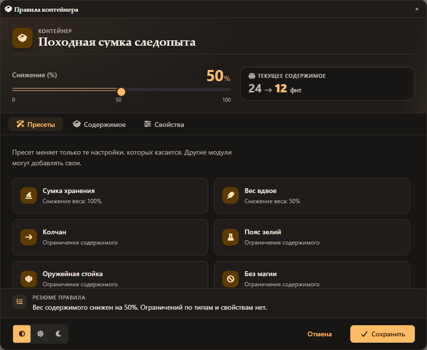
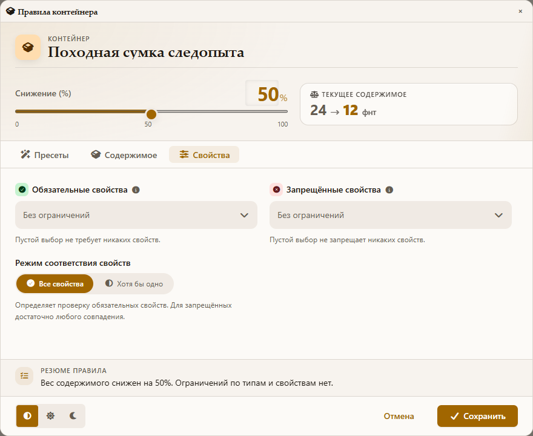

**English** · [Русский](README.ru.md)

# Weighty Containers

**Container weight reduction, capacity enforcement, and content rules for D&D 5e in Foundry VTT.**

Configure a bag that reduces the weight of its contents, a quiver restricted to ammunition,
or a weapon rack filtered by item properties. Weighty Containers enforces rules when items
enter containers and feeds reduced weights straight into dnd5e's native encumbrance calculations.

**Version:** 3.10.1 · **Languages:** English, Russian · **Author:** TacticalOtaku

[-2b6cb0?style=flat-square)](https://foundryvtt.com/)
[](https://github.com/foundryvtt/dnd5e)
[](LICENSE)

[Installation](#installation) · [Quick Start](#quick-start) · [Settings](#module-settings) · [API](API.md) · [Design System](DESIGN.md)

## Features

- **Weight reduction from 0% to 100%.** Slider, numeric input, and live result preview.
- **Capacity enforcement.** Enforces weight and item-count limits defined on dnd5e containers.
- **Content restrictions.** Filter allowed item types, categories, and subtypes.
- **Property rules.** Required and forbidden dnd5e item properties, matching either all required properties or any one.
- **Nested containers.** Accounts for nested container contents when checking outer container capacity.
- **Built-in presets.** One-click setups for common fantasy containers.
- **Block or warn mode.** Choose whether violations block moves or warn, and who sees rejection notices.
- **Light & dark themes.** Follow Foundry's window theme or override it per client.
- **Ergonomic editor.** Searchable multiselect lists, rule summary bar, conflict highlighting, and unsaved-changes guard.
- **Player read access.** Container owners can inspect active rules read-only; only GMs can edit them.

## Compatibility

| Component | Minimum | Verified in manifest |
| --- | --- | --- |
| Foundry VTT | 14 | 14.367 |
| D&D 5e system | 5.3.3 | 5.3.3 |

No required module dependencies. **socketlib** is supported optionally (native Foundry sockets are used when absent). **libWrapper is not required.**

With **Item Piles** (and **Item Piles: D&D 5e**), transfers, trades, and "Take All" actions are validated before Item Piles moves anything: if an item exceeds capacity or breaks container rules, the operation cancels cleanly without losing items. Containers moved with contents are weighed full; in warn mode a warning is shown and the transfer proceeds.

Designed for **D&D 5e**; other game systems are not supported.

## Installation

1. In Foundry VTT Setup, open **Add-on Modules → Install Module**.
2. Paste the **Manifest URL** below and click **Install**.
3. Open a D&D 5e world, go to **Manage Modules**, and enable **Weighty Containers**.

```text
https://github.com/TacticalOtaku/Weighty-Containers/releases/latest/download/module.json
```

Release archives are also available on [GitHub Releases](https://github.com/TacticalOtaku/Weighty-Containers/releases).
For manual installation, extract the archive into `Data/modules/weighty-containers` so `module.json` sits directly inside that folder.

## Quick Start

1. Log in as **Gamemaster** and open a **Container** item sheet.
2. Click the gear button (**Container Rules**) in the sheet header next to window controls.
3. Set the weight reduction percentage. The preview uses live contents weight when available or a sample weight otherwise.
4. Optionally apply a preset or configure type/subtype/property restrictions.
5. Review the summary footer and click **Save**.

Capacity itself is configured in dnd5e's native container fields; Weighty Containers builds on top of those settings.
Owning players see an eye button to inspect container rules in read-only mode without modifying them.

## How Rules Work

### Weight

Reduction scales the counted weight of the container's **contents**, never the container's own base weight.
At 50% reduction, 20 lb of contents contribute 10 lb, added to the bag's own weight.

The module patches dnd5e's `ContainerData#contentsWeight` getter, so capacity bars, container totals, and actor encumbrance all reflect the reduction natively. Nested reductions compound down the chain. Containers with dnd5e's `weightlessContents` property (such as a Bag of Holding) contribute zero content weight to their carrier while still tracking their own internal capacity as on the dnd5e sheet.

Unit conversions follow `CONFIG.DND5E.weightUnits` (e.g., `1 kg = 2.5 lb` in metric dnd5e worlds). Container coins use the container's `weight.units`, while actor coins use the world display unit. See [API.md](API.md#weight) for calculation details.

### Content Restrictions

On the **Restrictions** tab, pick allowed item types and subtypes/categories. Available subtypes follow the selected types (including ammunition subtypes like arrows and bolts). Leaving a list empty imposes no restriction for that dimension. Item properties are checked strictly on the **Properties** tab and do not satisfy subtype rules.

### Properties

On the **Properties** tab, configure:

- **Required properties:** an item must carry either **all** listed properties or **at least one**, depending on the match mode.
- **Forbidden properties:** matching any single forbidden property rejects the item.

Saving is blocked with a clear conflict message if the same property is both required and forbidden.

## Built-in Presets

| Preset | Changes applied |
| --- | --- |
| Bag of Holding | 100% content weight reduction |
| Half Weight | 50% content weight reduction |
| Quiver | Consumables with ammunition subtype |
| Potion Belt | Consumables with potion subtype |
| Weapon Rack | Weapon items only |
| No Magic | Forbids the `mgc` property |
| Reset All | Clears reduction and restrictions; resets required match mode to All |

Presets only overwrite the fields they define (for example, applying **Quiver** preserves your existing weight reduction). Remember to click **Save** after applying a preset.

## Module Settings

Open Foundry **Module Settings → Weighty Containers**:

| Setting | Purpose | Default |
| --- | --- | --- |
| **Over-capacity behavior** | Block violating actions or warn only | Block |
| **Include nested containers** | Count nested container contents toward outer capacity (disabling weighs sub-containers by own weight only; actor encumbrance stays accurate) | Enabled |
| **Who sees rejections** | Acting player only; acting player, owners & GMs; or everyone | Acting player, owners & GMs |
| **Window theme** | Auto, Light, or Dark | Auto |
| **Custom exceed message** | GM override for capacity rejection text (`{containerName}`, `{before}`, `{delta}`, `{capacity}`, `{unit}`) | Default message |
| **Log level** | Diagnostic verbosity in browser console | Warnings |

## Interface & Themes

Windows follow the **Anvil** design system: neutral surfaces, brass-amber accents, crisp labels, keyboard navigation, and reduced-motion support.

<details>
<summary>Light & dark theme previews</summary>





</details>

Design tokens and porting guidelines are documented in [DESIGN.md](DESIGN.md).

## Developer API

Weighty Containers exposes **Public API v2** for querying load/capacity, validating restrictions, opening the rules window, and registering custom presets:

```js
Hooks.once("weighty-containers.ready", api => {
  api.registerRulePreset({
    id: "my-module.scroll-case",
    label: "Scroll Case",
    icon: "fas fa-scroll",
    config: {
      allowedTypes: ["consumable"],
      allowedSubtypes: ["scroll"]
    }
  });
});
```

Full API documentation: [API.md](API.md).

### Development Checks

Requires **Node.js 24+** (vanilla ES modules, no build step needed):

```sh
npm install
npm run check    # ESLint and node --test suite
npm run deploy   # Copy module into Foundry Data/modules/weighty-containers
npm run release  # Check and package dist/weighty-containers-v<version>.zip
```

Manual Foundry verification checklist: [tests/manual/foundry-v14-smoke.md](tests/manual/foundry-v14-smoke.md).

## Reporting Issues & Contributing

Pull Requests are disabled on this repository. Please report bugs or suggest features via [GitHub Issues](https://github.com/TacticalOtaku/Weighty-Containers/issues) (see [CONTRIBUTING.md](CONTRIBUTING.md)) and include:

- Foundry VTT, D&D 5e, and Weighty Containers versions;
- reproduction steps, expected vs. actual behavior, and user role (GM/Player);
- container rules, affected items, weight units, and whether nested containers are involved;
- console errors and output from `weightyCont.dumpLog()`.

## License

Released under the **GNU General Public License v3.0** ([LICENSE](LICENSE)).
