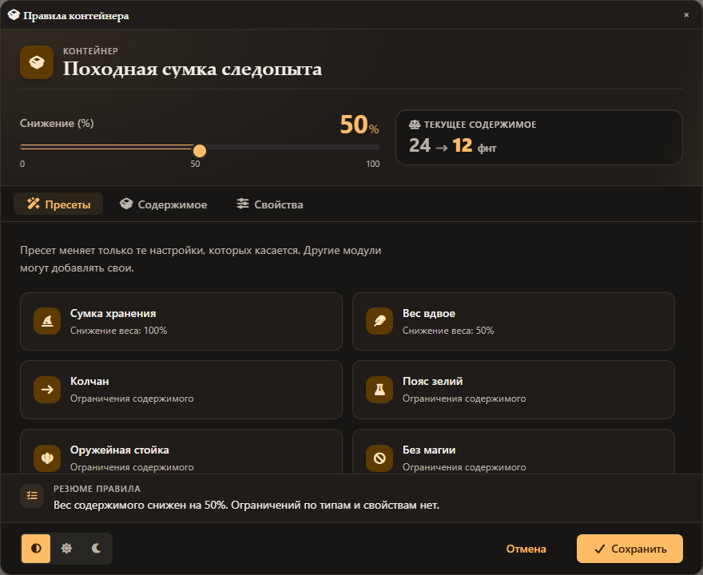
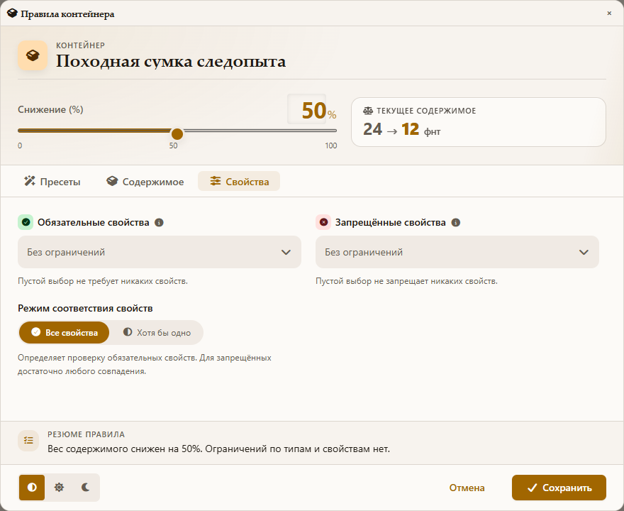

<div align="center">

[English](README.md) · **Русский**

# Weighty Containers

**Управление весом, вместимостью и правилами содержимого контейнеров в Foundry VTT для D&D 5e**

Настройте сумки, уменьшающие вес содержимого, колчаны только для боеприпасов или оружейные стойки со строгими фильтрами по свойствам предметов — правила проверяются автоматически и сразу учитываются в нагрузке системы.

[](https://github.com/TacticalOtaku/Weighty-Containers/releases/latest)
[](https://github.com/TacticalOtaku/Weighty-Containers/actions/workflows/ci.yml)
[](https://foundryvtt.com/)
[](https://github.com/foundryvtt/dnd5e)
[](lang/)
[](LICENSE)

[Установка](#установка) · [Скриншоты](#скриншоты) · [Быстрый старт](#быстрый-старт) · [Возможности](#возможности) · [Как работают правила](#как-работают-правила) · [Настройки](#настройки-модуля) · [API](API.md) · [Разработка](#разработка)

</div>

---

## Установка

Вставьте **URL манифеста** в окно установки модулей Foundry VTT (**Setup → Add-on Modules → Install Module**):

```text
https://github.com/TacticalOtaku/Weighty-Containers/releases/latest/download/module.json
```

**Требования:** Foundry VTT **14** (проверено на `14.367`), D&D 5e **`5.3.3+`**. **Обязательных модулей-зависимостей нет** (`socketlib` `1.0.0+` поддерживается опционально, без него используются штатные сокеты Foundry; `libWrapper` не требуется).  
**Ручная установка:** скачайте `weighty-containers-v<версия>.zip` со страницы [GitHub Releases](https://github.com/TacticalOtaku/Weighty-Containers/releases/latest), распакуйте в `Data/modules/weighty-containers` (чтобы `module.json` находился в корне этой папки) и включите **Weighty Containers** в мире D&D 5e.

---

## Скриншоты




---

## Быстрый старт

1. Войдите в мир как **Мастер** и откройте лист предмета типа **Container / Контейнер**.
2. Нажмите кнопку с шестерёнкой **«Правила контейнера»** в заголовке окна листа рядом с кнопками управления окном.
3. Установите процент снижения веса (поле результата показывает вес текущего содержимого, когда он доступен; иначе используется пример веса).
4. При необходимости примените пресет или задайте ограничения вручную.
5. Проверьте резюме внизу окна и нажмите **«Сохранить»**.

Вместимость задаётся в штатных настройках самого контейнера D&D 5e; правила модуля дополняют эти настройки. Игроку-владельцу доступна кнопка просмотра с глазом для инспекции правил в режиме «только чтение».

---

## Возможности

- **Снижение веса от 0 до 100%:** ползунок, числовой ввод и предварительный расчёт результата.
- **Контроль вместимости:** проверка ограничений по весу или количеству предметов, заданных у контейнера.
- **Правила содержимого:** разрешённые типы, категории и подтипы предметов.
- **Правила свойств:** обязательные и запрещённые свойства D&D 5e; соответствие всем обязательным свойствам или хотя бы одному.
- **Вложенные контейнеры:** учёт содержимого вложенных сумок и проверка вместимости внешних контейнеров.
- **Готовые пресеты:** быстрая настройка распространённых вариантов контейнеров.
- **Блокировка или предупреждение:** выбор поведения при нарушении правил и получателей уведомлений.
- **Светлая и тёмная темы:** дизайн-система **Anvil** — нейтральные поверхности, янтарный акцент, адаптивность, навигация с клавиатуры, поддержка уменьшения движения и выбор «Авто / Светлая / Тёмная».
- **Удобное редактирование:** поиск в списках, множественный выбор, резюме правил, подсветка конфликтов и предупреждение о несохранённых изменениях.
- **Доступ для игроков:** владельцы контейнеров могут просматривать правила; изменять их может Мастер.

---

## Совместимость и интеграции

| Компонент                      | Совместимость                              | Поведение                                                                                                                                                                                                             |
| ------------------------------ | ------------------------------------------ | --------------------------------------------------------------------------------------------------------------------------------------------------------------------------------------------------------------------- |
| **Foundry VTT**                | `14` (проверено `14.367`)                  | Использует нативное ApplicationV2 и штатные сокеты Foundry                                                                                                                                                            |
| **Система D&D 5e**             | `5.3.3+` (проверено `5.3.3`)               | Разработан специально для `dnd5e`; другие системы не поддерживаются                                                                                                                                                   |
| **socketlib** _(опционально)_  | `1.0.0+`                                   | Используется при наличии; без него применяются штатные сокеты Foundry                                                                                                                                                 |
| **Item Piles** _(опционально)_ | С мостом `Item Piles: D&D 5e` или без него | Переносы, торговля и «взять всё» проверяются в pre-хуках до списания с источника; перенос контейнера с содержимым проверяется с полным весом; в режиме предупреждения показывается уведомление, и перенос выполняется |

---

## Как работают правила

### Вес

Процент снижает учитываемый вес **содержимого**, а не собственный вес контейнера. При снижении на 50% предметы общим весом 20 фунтов дают 10 фунтов содержимого; собственный вес сумки учитывается отдельно.

Снижение включается в системный расчёт `contentsWeight`, на котором D&D 5e строит вес контейнера, показатель вместимости и нагрузку персонажа. Вложенные снижения могут применяться последовательно. Системное свойство `weightlessContents` (например, у сумки хранения) убирает содержимое из веса того, кто несёт контейнер, но собственная вместимость контейнера по-прежнему считается по содержимому — как на шкале вместимости D&D 5e.

Модуль использует единицы и коэффициенты преобразования D&D 5e (`CONFIG.DND5E.weightUnits`), чтобы значения совпадали с листами системы: монеты в контейнере считаются в `weight.units` контейнера, монеты персонажа — в единицах отображения мира (в метрическом мире `1 кг = 2,5 фунта`). Подробности расчётов приведены в [API.md](API.md#weight).

### Ограничения содержимого

На вкладке **«Ограничения»** выберите разрешённые типы и категории/подтипы. Список категорий зависит от выбранных типов; для боеприпасов доступны подтипы вроде стрел и болтов. Пустой выбор не ограничивает соответствующий параметр. Свойства предметов проверяются только на вкладке **«Свойства»** и не засчитываются как подтипы.

Если после изменения типов ранее выбранные категории стали недоступны, окно покажет предупреждение и предложит показать или удалить эти значения.

### Свойства

На вкладке **«Свойства»** задайте:

- **Обязательные свойства:** предмет должен иметь все выбранные свойства либо хотя бы одно — в зависимости от режима соответствия.
- **Запрещённые свойства:** достаточно любого совпадения, чтобы предмет нарушал правило.

Пустые списки не добавляют требований. Если одно свойство одновременно обязательно и запрещено, сохранение недоступно до исправления конфликта. Названия типов и свойств берутся из каталогов системы (часть названий может отображаться на английском).

### Готовые пресеты

| Пресет               | Изменения                                                           |
| -------------------- | ------------------------------------------------------------------- |
| **Сумка хранения**   | Снижение веса содержимого на 100%                                   |
| **Вес вдвое**        | Снижение веса содержимого на 50%                                    |
| **Колчан**           | Расходуемые предметы с подтипом боеприпасов                         |
| **Пояс зелий**       | Расходуемые предметы с подтипом зелий                               |
| **Оружейная стойка** | Предметы типа «Оружие»                                              |
| **Без магии**        | Запрет свойства `mgc`                                               |
| **Сбросить всё**     | Сброс снижения веса и ограничений, режим обязательных свойств «Все» |

Пресет меняет только перечисленные в нём параметры (например, **«Колчан»** сохраняет уже настроенный процент снижения веса). Применённые изменения нужно сохранить кнопкой **«Сохранить»**. Названия пресетов описывают настройку: модуль не создаёт предметы и не реализует дополнительные эффекты магических предметов.

---

## Настройки модуля

Откройте настройки Foundry и найдите раздел **Weighty Containers**:

| Настройка                          | Назначение                                                                                                                                                  | По умолчанию                       |
| ---------------------------------- | ----------------------------------------------------------------------------------------------------------------------------------------------------------- | ---------------------------------- |
| **Поведение при превышении**       | Блокировать действие или только предупреждать о нарушении вместимости/правил                                                                                | Блокировать                        |
| **Учитывать вложенные контейнеры** | Содержимое вложенных контейнеров входит во вместимость внешнего (если выключено, учитывается только собственный вес, переносимый вес персонажа не меняется) | Включено                           |
| **Кто видит отказы**               | Только действующий игрок; действующий игрок, владельцы и ГМы; либо все                                                                                      | Действующий игрок, владельцы и ГМы |
| **Тема окон**                      | Авто, светлая или тёмная                                                                                                                                    | Авто                               |
| **Текст уведомления о превышении** | Текст ГМа вместо стандартного сообщения (`{containerName}`, `{before}`, `{delta}`, `{capacity}`, `{unit}`)                                                  | Стандартное сообщение              |
| **Уровень логирования**            | Подробность диагностических записей                                                                                                                         | Предупреждения                     |

Настройки правил и уведомлений относятся к игровому миру; тема и параметры диагностики сохраняются отдельно для клиента.

---

## API для разработчиков

Модуль предоставляет **Public API v2** для получения загрузки и вместимости, проверки правил, открытия окна настроек и регистрации собственных пресетов (подробнее в [API.md](API.md)):

```js
Hooks.once("weighty-containers.ready", (api) => {
  api.registerRulePreset({
    id: "my-module.scroll-case",
    label: "Футляр для свитков",
    icon: "fas fa-scroll",
    config: {
      allowedTypes: ["consumable"],
      allowedSubtypes: ["scroll"],
    },
  });
});
```

---

## Разработка

Исходники используют JavaScript ES modules; сборка для запуска в Foundry не требуется. Нужен **Node.js 24+**. GitHub Actions проверяет код в [ci.yml](.github/workflows/ci.yml) и публикует релизы по тегам `v*` через [release.yml](.github/workflows/release.yml).

```bash
npm install
npm run check    # ESLint и тесты node --test
npm run deploy   # Копия модуля в %LOCALAPPDATA%/FoundryVTT/Data/modules/weighty-containers (или FOUNDRY_DATA, --data <путь>)
npm run package  # Проверка module.json и сборка dist/weighty-containers-v<версия>.zip
npm run release  # Запуск check, затем сборка архива
```

### Документация проекта

| Документ                                                               | Назначение                                                            |
| ---------------------------------------------------------------------- | --------------------------------------------------------------------- |
| [API.md](API.md)                                                       | Методы API v2, `getCarriedShare`, события и миграция с v1             |
| [DESIGN.md](DESIGN.md)                                                 | Токены дизайн-системы Anvil, компоненты и правила переноса оформления |
| [docs/architecture.md](docs/architecture.md)                           | Слои архитектуры и устройство модуля                                  |
| [tests/manual/foundry-v14-smoke.md](tests/manual/foundry-v14-smoke.md) | Чек-лист ручной проверки в Foundry VTT 14                             |
| [CHANGELOG.md](CHANGELOG.md)                                           | Подробная история изменений по версиям                                |
| [CONTRIBUTING.md](CONTRIBUTING.md)                                     | Правила отправки багрепортов                                          |

---

## Обратная связь и лицензия

Pull Requests в этом репозитории отключены. Создайте [GitHub Issue](https://github.com/TacticalOtaku/Weighty-Containers/issues) (см. [CONTRIBUTING.md](CONTRIBUTING.md)) и укажите:

- версии Foundry VTT, D&D 5e и Weighty Containers;
- шаги воспроизведения, ожидаемый и фактический результат, роль пользователя (Мастер или игрок);
- правила контейнера, затронутые предметы, единицы веса и наличие вложенных контейнеров;
- снимок экрана, ошибки консоли и вывод `weightyCont.dumpLog()`.

Проект распространяется по лицензии **GNU General Public License v3.0** ([LICENSE](LICENSE)).
